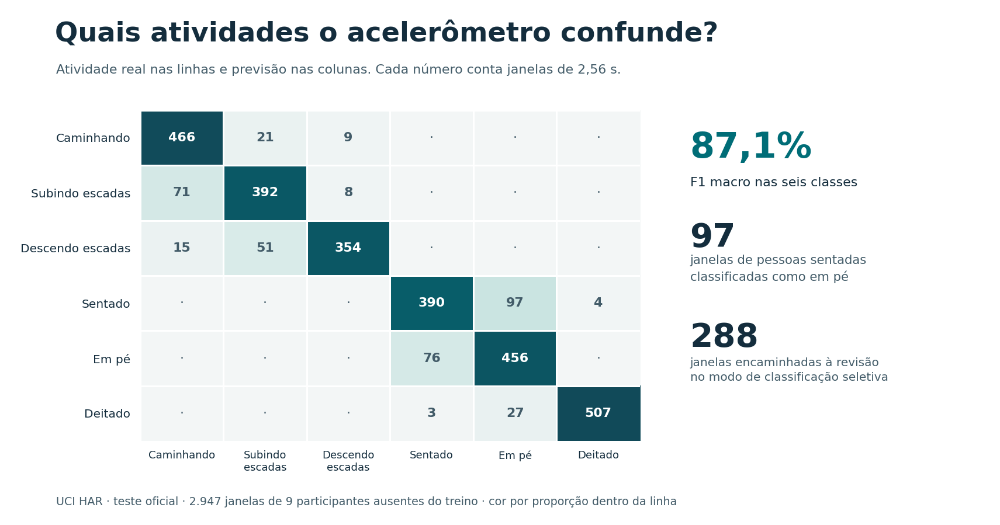

# Motion HAR

**É possível reconhecer movimento usando apenas o acelerômetro de um smartphone?** Este projeto classifica janelas de 2,56 segundos em seis atividades cotidianas e pode encaminhar sinais ambíguos para revisão. Usa os três eixos de aceleração total da base UCI HAR, coletada com um **Samsung Galaxy S II na cintura**. O modelo exportado ocupa cerca de **135 KiB** e faz inferência local com NumPy.

No teste oficial, o modelo obteve **F1 macro de 0,8705** em **2.947 janelas de nove pessoas ausentes do treino**. A figura mostra onde ele erra. Das 491 janelas de pessoas sentadas, 97 foram classificadas como “em pé”.



## Experimentar o modelo

Use Python 3.12 e, de preferência, um ambiente virtual. Estes comandos usam o modelo já treinado e as janelas incluídas. A instalação de bibliotecas é a única etapa da demonstração que pode precisar de internet.

```bash
python -m pip install -r requirements-inference.txt
python inference.py data/examples/activity-1.csv
python inference.py data/examples/activity-4.csv
python verify.py
```

O primeiro exemplo identifica caminhada. No segundo, o rótulo real é **sentado** e a previsão é **em pé**, com escore de **0,9256**. Esse erro com escore alto ilustra por que o limiar de revisão, sozinho, é insuficiente para garantir uma classificação correta. `verify.py` recalcula as 2.947 previsões e as compara, linha por linha, com o arquivo de evidência. [Janelas e rótulos de origem](data/manifest.json)

## Desenho do experimento

- **Entrada.** São 128 leituras a 50 Hz, em unidades de gravidade, com a gravidade incluída no sinal. O modelo usa 39 atributos próprios, entre eles orientação média, dispersão, autocorrelação, correlação entre eixos e energia em bandas de frequência. Os 561 atributos prontos da UCI e o giroscópio ficam fora da entrada. [Extração de atributos](features.py)
- **Separação por pessoa.** O conjunto oficial reserva 7.352 janelas de 21 pessoas para desenvolvimento e 2.947 janelas de outras nove para teste. No desenvolvimento, cinco folds também separam pessoas. Isso importa porque janelas adjacentes compartilham 50% das leituras. O escalonador é ajustado dentro de cada fold.
- **Seleção.** A regressão logística linear alcançou F1 macro de **0,8869** nas previsões fora do fold. A regressão com 384 atributos aleatórios de Fourier para aproximar um kernel RBF alcançou **0,8886**. A regra predefinida escolheu o maior F1 macro. A pequena diferença recomenda cautela ao atribuir vantagem ao modelo mais complexo.
- **Teste.** A referência que sempre prevê a classe mais frequente do treino obteve **0,0514 de F1 macro** no mesmo teste. O modelo selecionado obteve **0,8705**, com **87,04% de acurácia**. O intervalo percentil de 95% para o F1 macro, estimado por 2.000 reamostragens dos nove participantes de teste, foi **0,793 a 0,933**. Ele expressa a variação observada entre essas pessoas.
- **Revisão seletiva.** O percentil 10 do maior escore nas previsões fora do fold fixou o limiar em **0,6728**. No teste, 2.659 de 2.947 janelas passaram pelo limiar (**90,23% de cobertura**). Nessas janelas aceitas, o F1 macro foi **0,8984**. As outras 288 foram encaminhadas à revisão. [Métricas e IDs dos participantes](release/evaluation.json) · [Previsões individuais](release/test-predictions.csv.gz)

## Reproduzir o treino

```bash
python -m pip install -r requirements.txt
python train.py --out .local/retrained
python inference.py data/examples/activity-1.csv --model .local/retrained/model.npz
python -m unittest discover -s tests -v
```

A tabela compacta de atributos já acompanha o projeto. Para reconstruí-la a partir do ZIP oficial, execute `python prepare.py --out .local/data` e depois `python train.py --data .local/data --out .local/retrained`. O preparador confere o SHA-256 do arquivo original. Para usar um download local, acrescente `--archive caminho/do/arquivo.zip`. A semente, os folds e as versões das bibliotecas estão registrados. [Treino e exportação](train.py) · [Reconstrução da base](prepare.py)

O artefato `.npz` contém pesos numéricos, nomes de atributos, ordem das classes e limiar. Antes da exportação ser aceita, as probabilidades da implementação NumPy são comparadas às do scikit-learn em todas as janelas de teste. O gráfico pode ser regenerado com `python plot.py` após instalar Matplotlib.

Cada treino é avaliado em uma pasta temporária antes de ser promovido para o destino. Repetir o treino com o mesmo resultado conserva a versão anterior. Se houver diferença, escolha um novo caminho em `--out` para comparar as versões.

## Aplicação e limites

O CSV de entrada precisa das colunas `t_ms,ax_g,ay_g,az_g`, com 128 linhas e intervalo de 20 ms (tolerância de 2 ms). O treino usou sinais pré-processados pela UCI, de voluntários em condições controladas. Um aparelho no bolso, no pulso, em outra orientação ou com outro pré-processamento exige validação própria. A tarefa reconhece as seis atividades da base. O escore é uma saída do classificador, sem calibração independente para novos dispositivos.

## Dados e atribuição

Base **Human Activity Recognition Using Smartphones**, de Jorge Reyes-Ortiz, Davide Anguita, Alessandro Ghio, Luca Oneto e Xavier Parra. A tabela de atributos e os exemplos de sinal são derivados dessa base. [Registro e DOI](https://doi.org/10.24432/C54S4K) · [Créditos e condições de uso](DATA.md)
